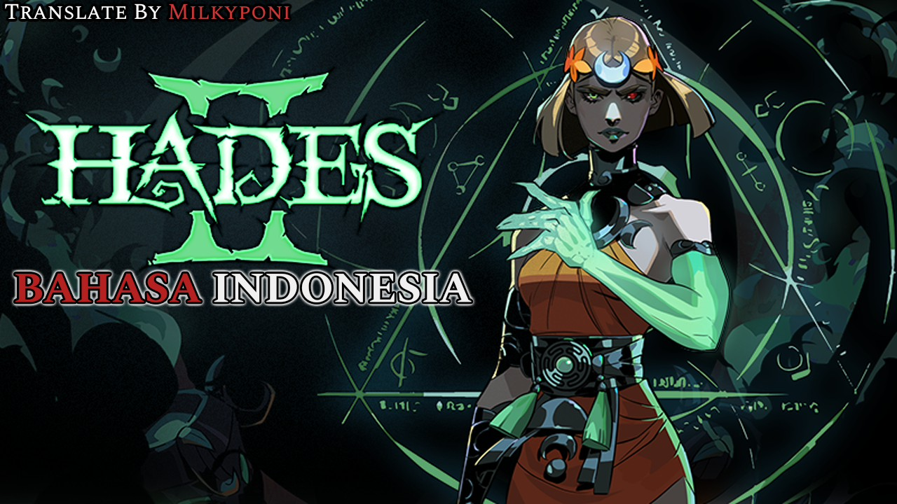

  

<h1 align="center">Hades II Indonesian Localization</h1>

  <b>Mod Lokalisasi & Subtitle Bahasa Indonesia untuk Game Hades II (PC)</b> 
  <i>Penyelia & Pengarah: Milkyponi | Rekayasa Mod & Lokalisasi: Ochi (Milky Brain)</i>

  
  
  
  
  

---

Mod lokalisasi Bahasa Indonesia untuk game **Hades II** (PC) karya **Milky Brain Game Modding & Localization Division**.

Dibuat khusus bagi gamer Indonesia yang ingin menikmati narasi gelap nan puitis mitologi Yunani, intrik keluarga para dewa, serta pergulatan Melinoë melawan Sang Titan Waktu, Chronos—dalam Bahasa Indonesia yang hidup, luwes, dan berkarakter tanpa menghilangkan istilah mekanik gameplay internasional.

---

## ✨ Fitur Utama (Context-Aware & Engine Engineering)

### 1. Terjemahan Kontekstual & Berjiwa Karakter (Anti-Google Translate)
Diterjemahkan berbasis adegan utuh (*scene-level*), menjaga emosi, dinamika relasi, dan kepribadian khas tiap tokoh di dunia Supergiant Games:
* **Melinoë**: Putri Dunia Bawah, penyihir muda penuh tekad, tenang, sopan, namun mematikan dan berwibawa di medan tempur.
* **Hecate**: Guru sekaligus figur pelindung, tegas, maternal, dan berwibawa tinggi (*"Bersama kita bersinar", "Kematian bagi Chronos"*).
* **Chronos**: Sang Titan Waktu, angkuh, dingin, manipulatif, dan memandang rendah cucunya serta anak-anaknya di Olympus.
* **Dora**: Hantu kecil sekamar Melinoë, sarkastik, ceria, usil, tapi setia menemani di kemah Crossroads.
* **Nemesis**: Rival sengit Melinoë, sinis, kompetitif, dingin menusuk, namun diam-diam memiliki kepedulian yang tertahan.
* **Moros & Hypnos**: Moros yang melankolis dan santun; Hypnos sang Dewa Tidur yang gemar mengigau lucu di tempat peristirahatannya.
* **Para Dewa Olympus**: Karismatik, penuh drama keluarga, lelucon sarkastik Duo Boons, hingga tawa terbahak-bahak khas Poseidon.
* **Scylla & the Sirens**: Lirik lagu konser dasar laut yang digubah berirama, menggoda, puitis, dan mematikan.

### 2. Standar Bahasa Resmi (English UI / Indonesian Dialogue)
* **Subtitle & Narasi Cerita (100% Bahasa Indonesia)**: Mencakup 30.741 baris dialog naratif cerita utama, obrolan santai Crossroads, ujian bos, interaksi hewan pendamping (Familiars), reaksi memancing, hingga celetukan ambient tempur.
* **UI, HUD & Boons (100% Original English)**: Menu utama, opsi pengaturan, HUD tempur, nama dewa, nama senjata, Weapon Aspects, Daedalus Hammer, dan seluruh penjelasan deskripsi Boon tetap dalam Bahasa Inggris original agar familiaritas gaming dan panduan build internasional tetap 100% nyaman diikuti.

### 3. Sinkronisasi Fonetik Kata Terbata-Bata (*Stuttering Guardrail*)
Mengatasi kelemahan umum pada lokalisasi game di mana kata gagap sering tidak sinkron dengan kata terjemahannya:
* *Skelly (`Skelly_0372`)*: `b-but... a-are you prepared...` ➔ **`t-tapi... s-siapkah kau...`** *(sinkron huruf awal kata 'tapi' & 'siapkah')*
* *Eris (`ErisField_0049`)*: `c-c-consequences` ➔ **`a-a-akibat`**
* *Arachne (`Arachne_0129`)*: `wha-what is that?` ➔ **`a-apa itu?`**
* *Icarus (`Icarus_0255`)*: `C-Can you make more?` ➔ **`B-Bisa kau buatkan lagi?`**

### 4. Dual-Slot Compatibility & Zero-Friction
* Bekerja otomatis baik pada slot default **English (`en`)** maupun slot **Bahasa Indonesia (`pt-BR`)**.
* Tidak memerlukan mod loader atau injector eksternal. Struktur *drop-in native* yang aman dari crash dan bebas risiko terhadap file save game.

---

## 📥 Panduan Instalasi (Cara Pasang)

### Langkah Cepat:
1. Unduh arsip **`Hades2Indo_v1.0.0.zip`** dari folder [**`release/`**](release/Hades2Indo_v1.0.0.zip) atau halaman Releases.
2. Buka direktori instalasi game **Hades II** di PC:
   * **Steam**: Buka Steam Library ➔ Klik kanan **Hades II** ➔ **Manage** ➔ **Browse local files**.
   * Contoh lokasi:  
     `.../SteamLibrary/steamapps/common/Hades II/`
3. Ekstrak file zip langsung ke direktori root **Hades II** tersebut (timpa / *replace all* bila muncul notifikasi).
4. Buka game Hades II lewat Steam dan langsung mainkan!
   *(Opsi: Anda juga dapat memilih menu **Options** ➔ **Language** ➔ **"Bahasa Indonesia"**)*.

---

## 🔄 Cara Uninstall (Kembali ke Versi Asli)

- **Cara Otomatis via Steam**:
  1. Klik kanan **Hades II** di Steam Library.
  2. Pilih **Properties** ➔ **Installed Files**.
  3. Klik **Verify integrity of game files**.

---

## 📋 Cakupan File yang Dimodifikasi

Semua modifikasi beroperasi secara murni pada layer data Supergiant Games (`Content/Game/Text/`):
* `Content/Game/Text/Languages.sjson` (Injeksi opsi pilihan 'Bahasa Indonesia').
* `Content/Game/Text/pt-BR/*.sjson` (181 file teks lokalisasi slot Bahasa Indonesia).
* `Content/Game/Text/en/*.sjson` (181 file teks slot default English untuk kompatibilitas langsung tanpa ganti menu).

---

## 👑 Tim Pengembang & Kredit

* **Pengarah & Sutradara Proyek**: [Milkyponi](https://github.com/Milkyponi) (CEO Milky Brain)
* **Rekayasa Mod & Lokalisasi**: Ochi (Kepala Divisi Game Modding & Lokalisasi - Milky Brain)
* **Banner Artwork**: Milkyponi
* **Arsitektur Pipeline**: Hermes Agent Platform
* **Pengembang Game**: [Supergiant Games](https://www.supergiantgames.com/) (*Hades II*)

---

## ⚖️ Lisensi & Penafian

Mod ini adalah karya proyek komunitas nirlaba (*non-commercial fan translation*). Seluruh hak cipta aset visual, audio, karakter, dan cerita dasar merupakan milik Supergiant Games.

---

## ☕ Dukung Proyek Ini (Donate)

Jika mod lokalisasi Bahasa Indonesia ini bermanfaat bagi pengalaman bermain Anda, Anda dapat memberikan dukungan pengembangan kepada **Milky Poni** melalui Trakteer:

  

- **Link Trakteer**: [https://trakteer.id/milkyponi](https://trakteer.id/milkyponi)
